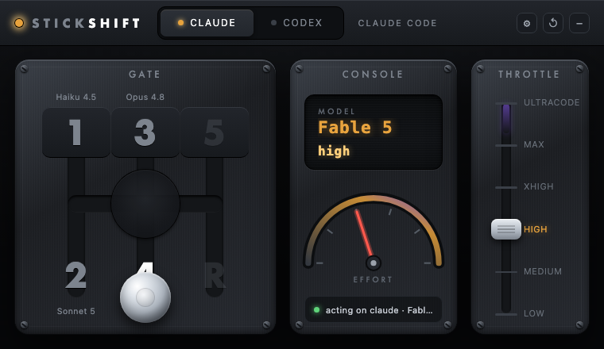
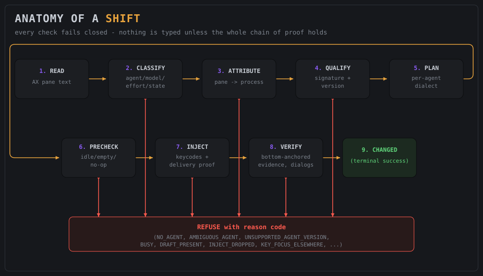
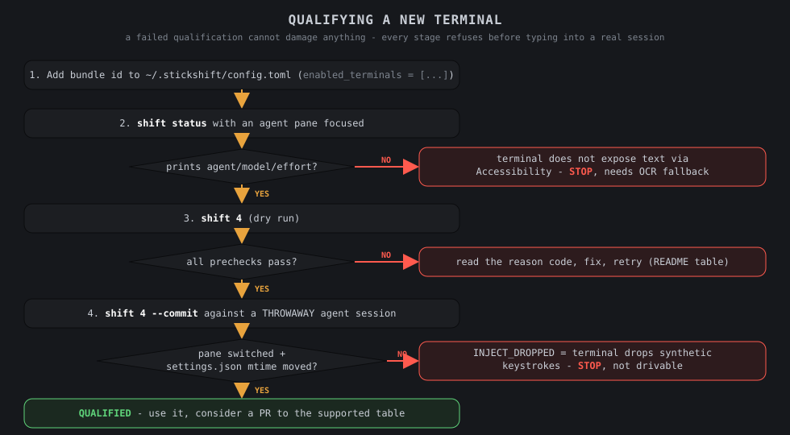
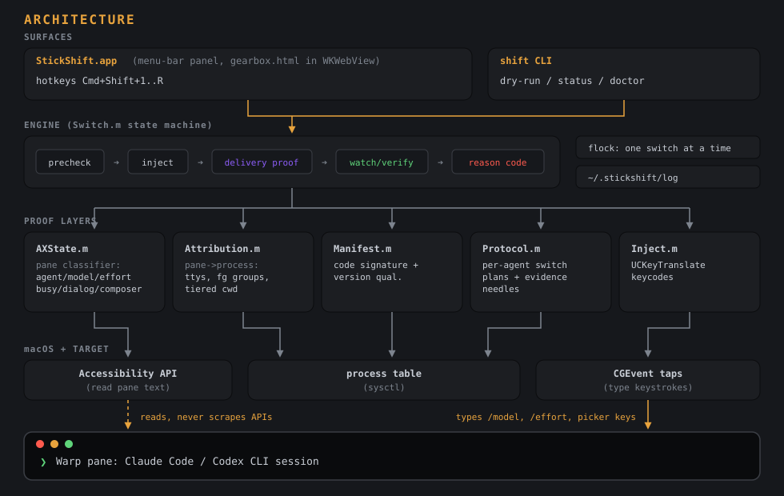

# StickShift

**🇧🇷 [Português](README.md) · 🇺🇸 [English](README.en.md) · 🇪🇸 [Español](README.es.md)**

**Model & Effort Panel** para Claude Code y Codex · *Panel de Modelo y Esfuerzo* · *Panel de Modelo y Esfuerzo*

Una palanca de cambios para la barra de menú de macOS que cambia el modelo de IA y el esfuerzo de razonamiento del agente que esté ejecutándose en el panel de terminal que estás viendo, ya sea Claude Code o Codex CLI. Lleva la palanca a una posición y cambia el modelo en ese panel. Mueve el acelerador y cambia el esfuerzo. Es una palanca de cambios en H con diseño esqueuomórfico para tus agentes de programación.



StickShift nunca edita archivos de configuración, nunca llama a las API de proveedores ni usa API de automatización de terminal. Lee el panel enfocado mediante Accesibilidad de macOS, comprueba que el panel contiene un agente local, firmado con código y calificado, inactivo y con el campo de entrada vacío, y luego escribe los mismos comandos que escribirías a mano (`/model`, `/effort` o las teclas del selector de Codex) como eventos reales del teclado. Si no puede comprobar algo, se niega a actuar y devuelve un código de motivo en lugar de pulsar una tecla.

## Inicio rápido

```sh
git clone https://github.com/earlyaidopters/stickshift && cd stickshift
./scripts/setup.sh
```

Cuando la aplicación lo solicite, concede el permiso de Accesibilidad, cierra y vuelve a abrir la aplicación una vez, enfoca un panel de terminal que esté ejecutando Claude Code o Codex y mueve la palanca. O puedes saltarte toda la lectura: indica a tu agente de programación que use este repositorio y dile **"set up StickShift on this Mac"**. `AGENTS.md` le explica todo, incluso cómo adaptarse a tu terminal y depurar las negativas.

Solo macOS (consulta la evaluación de portabilidad en `docs/WINDOWS.md`). Warp está verificado de principio a fin; otros terminales [se pueden calificar en cuatro pasos](#supported-terminals).

### Linux / WSL: StickShift v2 (panel web + chat)

En Linux (y en Windows mediante WSL), StickShift v2 controla Claude Code y Codex que se ejecuten en paneles de **tmux**: CLI, un **panel web** con esta misma palanca de cambios y un **chat de nivel 1** que envía prompts al agente del panel elegido. Solo usa la biblioteca estándar de Python 3. Validado en vivo el 2026-09-24 (Claude Code 2.1.282, Codex 0.156.1). Consulta [`v2/README.md`](v2/README.md) (en portugués) y el plan en [`docs/PLANO-LINUX-WINDOWS.md`](docs/PLANO-LINUX-WINDOWS.md).

```sh
ln -s "$PWD/v2/bin/stickshift2" ~/.local/bin/stickshift2
stickshift2 list && stickshift2 web
```

---

## Contenido

1. [La palanca de cambios](#the-gearbox)
2. [Modelo de seguridad](#safety-model)
3. [Anatomía de un cambio](#anatomy-of-a-shift)
4. [Instalación](#install)
5. [Identidad de firma y Accesibilidad](#signing-identity-and-accessibility)
6. [Uso de la aplicación](#using-the-app)
7. [Uso de la CLI](#using-the-cli)
8. [Cambios y configuración](#gears-and-configuration)
9. [Terminales compatibles](#supported-terminals)
10. [Registro y análisis forense](#logging-and-forensics)
11. [Códigos de motivo](#reason-codes)
12. [Calificación de agentes](#agent-qualification)
13. [Pruebas](#testing)
14. [Mapa del código fuente](#source-map)
15. [Índice de hallazgos](#findings-index)
16. [Limitaciones conocidas y trabajo pendiente](#known-limitations-and-deferred-work)

---

## La palanca de cambios

El panel es un conjunto de instrumentos apaisado de 760x440 con tres placas.

- **GATE** (izquierda). Una palanca de cambios en H. Cada posición corresponde a un modelo; los nombres de los modelos están grabados arriba y debajo de cada número. Arrastra la perilla cromada a una posición para cambiar el modelo de ese panel. Las posiciones vacías rechazan la perilla.
- **CONSOLE** (centro). Una pantalla LCD muestra el modelo y el esfuerzo seleccionados; un tacómetro de esfuerzo, cuya aguja se mueve al accionar el acelerador (la cantidad de marcas se ajusta al rango de esfuerzo de cada modelo); y un indicador de estado en vivo que muestra en qué agente y panel está actuando StickShift. En la parte inferior aparecen avisos con el resultado de cada cambio.
- **THROTTLE** (derecha). Una palanca vertical de esfuerzo con una posición de retención para cada nivel y una zona roja morada en el nivel superior. Al llegar al nivel superior, se ilumina todo el panel.

La palanca de cambios tiene una **cara de Claude y una cara de Codex**, con un selector en el encabezado. Cada etiqueta coincide exactamente con las de su proveedor: el acelerador de Claude llega hasta **ULTRACODE** (Claude no tiene "ultra"), el de Codex hasta **ULTRA** (solo en los modelos que lo ofrecen), y cada etiqueta de esfuerzo usa los términos propios del proveedor (`xhigh` para Claude, `extra high` para Codex). El panel sigue automáticamente al agente detectado en el panel enfocado, y puedes cambiar de cara manualmente para previsualizar cualquiera de las dos. Botones del encabezado: panel de configuración (política de diálogos), restablecer la palanca al estado real del panel y contraerla a una barra delgada.

El panel es un NSPanel no activable que nunca puede convertirse en la ventana activa del teclado. Es un requisito de corrección, no una decisión de estilo: macOS envía los eventos del teclado (incluidos los sintéticos) a la ventana activa, así que un panel que capturara el foco del teclado se tragaría las mismas teclas que StickShift inyecta. Esto se comprobó en vivo; consulta el modelo de seguridad.

Atajos globales: **Cmd+Shift+1..5** y **Cmd+Shift+R** activan el cambio correspondiente en el panel enfocado sin abrir el panel.

## Modelo de seguridad

Todas las comprobaciones fallan de forma segura. El motor no escribe nada a menos que se cumpla toda la cadena de pruebas, y cada negativa devuelve un código de motivo legible por máquina (consulta la tabla más abajo). Cada invariante existe porque un fallo en vivo lo hizo necesario:

- **Prueba positiva de inactividad.** El panel debe mostrar el prompt de inactividad del agente, sin indicador de actividad (incluidas las variantes que no muestran "esc to interrupt"), sin diálogos abiertos y con el campo de entrada comprobablemente vacío. Se reconocen las sugerencias fantasma del marcador de posición según la versión del agente; todo lo que no se reconozca se trata como un borrador del usuario y se rechaza. Nunca se escribe encima de tu borrador ni se borra.
- **Atribución de procesos.** El directorio de trabajo que aparece en el panel se compara con el `cwd` real de los procesos del agente en primer plano en los `tty` del terminal. La coincidencia tiene niveles (una coincidencia exacta prevalece sobre una de directorio antecesor, que prevalece sobre una de directorio descendiente); solo se rechaza por ambigüedad si hay empate en el nivel más alto. Un panel de codex cuyo pie de página muestra la barra de sugerencias de comandos en vez de la ruta puede vincularse sin una pista de directorio, pero solo si es la única sesión de codex en ese terminal.
- **Calificación de la firma de código.** El binario atribuido debe tener el equipo de Developer ID del proveedor (Anthropic `Q6L2SF6YDW`, OpenAI `2DC432GLL2`), el identificador de código esperado, una firma válida y una versión de la lista calificada. Las versiones desconocidas se rechazan en vez de controlar una interfaz desconocida.
- **Teclas resueltas según la distribución.** El texto se escribe como códigos de tecla reales resueltos a partir de la distribución actual del teclado mediante `UCKeyTranslate`. Warp descarta silenciosamente el transporte de "carga Unicode en el código de tecla 0", que funciona en campos de texto nativos, así que ese transporte está prohibido. Si la distribución no puede producir un carácter, se rechaza la cadena completa.
- **Prueba de entrega.** Después de escribir y antes de pulsar Return, el comando escrito debe aparecer en el panel como una nueva ocurrencia respecto del recuento de referencia previo a la escritura. El texto idéntico que esté en el historial no puede simular la entrega. Si el terminal descartó las teclas, el cambio se cancela con `INJECT_DROPPED` en vez de pulsar Return a ciegas.
- **Invariante del foco del teclado.** En el momento de la inyección, el elemento enfocado globalmente en AX debe pertenecer al proceso del terminal; de lo contrario, se devuelve `KEY_FOCUS_ELSEWHERE`. Esto es lo que hace seguro hacer clic en el panel.
- **Invariante de antigüedad del fotograma.** La inyección solo ocurre dentro de los 150ms posteriores a la lectura de AX que se usó para validar el panel. Si la captura está desactualizada, se rechaza con `STALE_FRAME`.
- **Titularidad del diálogo.** Los diálogos de confirmación de Claude durante una conversación ("Switch model?", "Change effort level?") solo se responden si el destino extraído del diálogo coincide con el modelo o esfuerzo esperado para este cambio; se toleran adornos de Claude como "(1M context) (default)". Nunca se envían teclas a un diálogo ajeno, ni siquiera para cancelarlo.
- **Veredictos anclados al final.** Los indicadores de éxito y error solo cuentan en las últimas líneas del panel. El historial que cite un error antiguo o una línea de éxito anterior no puede hacer que una espera en vivo falle ni darla por cumplida.
- **Un cambio a la vez.** Un `flock` a nivel del sistema operativo se comparte entre la CLI y la aplicación durante cada ventana de inyección y verificación (`LOCKED`). La entrada segura del teclado en cualquier parte provoca una negativa (`SECURE_INPUT`). Se rechaza un cambio dirigido al panel donde se ejecuta la propia CLI (`SELF_TARGET`).

Consulta `PLAN.md` para ver la especificación completa y el registro de revisión adversarial.

## Anatomía de un cambio



Esto ocurre entre accionar la palanca y ver el aviso CHANGED:

1. **Leer.** Se lee el texto de la ventana del terminal enfocada mediante la API de Accesibilidad.
2. **Clasificar.** Un clasificador puro extrae del texto del panel el tipo de agente, modelo, esfuerzo, pista del directorio de trabajo, estado activo/inactivo/diálogo y si el campo de entrada está vacío. Se prueba con fixtures basados en capturas de todas las variantes de formato en vivo encontradas hasta ahora.
3. **Atribuir.** El panel se vincula a un proceso local: se enumeran los `tty` descendientes del terminal, se obtiene el líder del grupo de procesos en primer plano de cada `tty`, se detecta el tipo (claude por `comm`, codex por un binario nativo `codex` en el grupo en primer plano) y se compara la pista de `cwd` del panel con los `cwd` de los procesos según niveles de coincidencia.
4. **Calificar.** Se comprueban la firma, el equipo, el identificador y la versión del binario vinculado frente al manifiesto.
5. **Planificar.** Se crea un `SwitchPlan` para la tupla (modelo, esfuerzo) en el dialecto de ese agente. Los planes de Claude escriben los comandos `/model` y `/effort`; los planes de Codex usan el selector `/model` con selección de fila verificada por etiqueta (el número de fila se lee del texto del selector en vivo, nunca se presupone). Los planes que solo cambian el esfuerzo omiten el paso redundante del modelo si el panel ya muestra el modelo de destino.
6. **Comprobaciones previas.** Se comprueba si el agente está ocupado, si hay un diálogo abierto, si está inactivo, si el campo de entrada está vacío y si el cambio no hace falta (si ya está en el destino, se devuelve `ALREADY_SET` sin escribir nada).
7. **Inyectar.** Para cada lote: se vuelve a validar la identidad (título de ventana, geometría, actividad del proceso, foco del teclado), se comprueba la antigüedad del fotograma, se escribe con prueba de entrega y se espera a que se estabilice.
8. **Observar y verificar.** Se espera a que la línea de estado clasificada o la confirmación impresa muestre el estado de destino, anclado al final. Los diálogos de confirmación de Claude se manejan según la política configurada y solo si se comprueba que corresponden a esta acción.
9. **Informar.** El resultado (con código de motivo, etapa y detalle) aparece como aviso en el panel y se añade a `~/.stickshift/log`.

## Instalación

### La forma rápida

Usa el [Inicio rápido](#quick-start) de arriba: clona el repositorio y ejecuta `./scripts/setup.sh`. El script es idempotente y hace todo salvo el único paso que Apple reserva para ti: comprueba los requisitos previos, crea la identidad de firma estable si falta, compila, ejecuta toda la suite de pruebas y la matriz en la máquina real, instala en `~/Applications/StickShift.app` y la inicia. Luego concede el permiso de Accesibilidad cuando la aplicación lo solicite, ciérrala y vuelve a abrirla una vez, y listo.

### La forma con un agente de IA

Indica a Claude Code, Codex o cualquier agente de programación que use este repositorio y dile "set up StickShift on this Mac". El repositorio incluye `AGENTS.md` (con un alias `CLAUDE.md`), un manual operativo que explica al agente exactamente cómo instalar, verificar, adaptarse a tu terminal y a las versiones de tus agentes, y depurar negativas por código de motivo.

### La forma manual

Requisitos: macOS, herramientas de línea de comandos de Xcode (`clang`) y un terminal compatible (Warp es el predeterminado calificado; consulta [Terminales compatibles](#supported-terminals)).

```sh
make                # builds bin/shift (CLI) and bin/StickShift (app binary)
make test           # deterministic core test suite (no live panes needed)
make matrix         # qualifies THIS machine's agents + all 65 UI combinations
make app            # assembles + signs dist/StickShift.app
make install-app    # installs to ~/Applications/StickShift.app
make install-cli    # puts the CLI on PATH as `stickshift`
```

Después, inicia StickShift.app. La primera vez, solicita por sí misma el permiso de Accesibilidad, que registra el permiso para el binario correcto (consulta la siguiente sección; es importante). Concede el permiso en Configuración del Sistema, cierra y vuelve a abrir la aplicación una vez y listo.

Permisos usados:

1. **Accesibilidad** lee el texto del panel y envía pulsaciones de teclas. Es obligatorio.
2. **Grabación de pantalla** solo se usa como alternativa OCR para terminales que no exponen texto mediante Accesibilidad. Warp sí lo hace, así que no necesita Grabación de pantalla.

`shift doctor` muestra exactamente qué permisos están concedidos y cuáles faltan.

Para iniciar sesión al abrir la sesión: Configuración del Sistema, General, Ítems de inicio de sesión, añade `~/Applications/StickShift.app`.

## Identidad de firma y Accesibilidad

macOS vincula los permisos de Accesibilidad de TCC con la identidad de firma de código de la aplicación. Esto tiene una consecuencia delicada que obligó a conceder el permiso tres veces en una tarde:

- Una aplicación **firmada ad hoc** (`codesign -s -`) tiene un requisito designado igual al hash del binario. Cada recompilación genera un hash nuevo, así que cada reinstalación deja huérfano silenciosamente el permiso existente. El interruptor de Configuración del Sistema sigue apareciendo como activado aunque `AXIsProcessTrusted()` devuelva false.
- Los permisos se asocian al iniciar el proceso. Conceder el permiso a un proceso en ejecución no surte efecto hasta que se reinicie la aplicación.
- Las filas añadidas manualmente con el botón "+" pueden conservar un requisito obsoleto. La forma confiable de registrar el permiso es que la propia aplicación lo solicite (`AXIsProcessTrustedWithOptions` con la opción de mostrar el aviso), como hace StickShift al iniciarse si no es de confianza.

La solución está en el Makefile: la aplicación se firma con un **certificado autofirmado "StickShift Dev"** cuyo requisito designado es `identifier + certificate leaf`, estable entre recompilaciones. Concede Accesibilidad una vez y todas las ejecuciones futuras de `make install-app` conservarán el permiso. Si falta la identidad (en una máquina nueva), la compilación recurre a la firma ad hoc y muestra una advertencia clara. Para crear la identidad en una máquina nueva:

```sh
# 1. generate a self-signed code-signing cert (10 years)
openssl req -x509 -newkey rsa:2048 -keyout key.pem -out cert.pem -days 3650 -nodes \
  -subj "/CN=StickShift Dev" \
  -addext "keyUsage=critical,digitalSignature" \
  -addext "extendedKeyUsage=critical,codeSigning" \
  -addext "basicConstraints=critical,CA:false"
# 2. package + import into the login keychain, pre-authorizing codesign
openssl pkcs12 -export -legacy -out ss.p12 -inkey key.pem -in cert.pem \
  -name "StickShift Dev" -passout pass:sstemp
security import ss.p12 -k ~/Library/Keychains/login.keychain-db -P sstemp -T /usr/bin/codesign
# 3. trust it for code signing (password prompt)
security add-trusted-cert -p codeSign -k ~/Library/Keychains/login.keychain-db cert.pem
# 4. clean up the key material; the key now lives in the keychain
rm key.pem cert.pem ss.p12
```

Un Apple Developer ID de pago también resuelve esto y es la opción adecuada si StickShift alguna vez se distribuye más allá de tu propia máquina (una versión firmada también se registraría como ítem de inicio de sesión mediante `SMAppService`).

## Uso de la aplicación

- **Cambiar un modelo.** Enfoca el panel de destino en Warp y arrastra la perilla a una posición (o pulsa Cmd+Shift+gear). El panel nunca roba el foco, así que el panel de terminal queda listo para recibir las teclas.
- **Cambiar solo el esfuerzo.** Mueve el acelerador a un nivel o haz clic en una marca. Si el panel ya usa el modelo de destino, el plan omite `/model` por completo.
- **Diálogos de confirmación.** A veces Claude muestra los diálogos "Switch model?" o "Change effort level?" durante una conversación (se vuelve a leer la caché de la conversación). El panel de configuración (botón del engranaje) permite elegir la política: **Auto-confirm** (accionar la palanca cuenta como tu confirmación; predeterminado de la aplicación), **Ask me** (el diálogo queda abierto en el terminal) o **Auto-cancel** (nunca cambiar a mitad de una conversación). La elección se guarda en `~/.stickshift/config.toml`.
- **Restablecer.** El botón de restablecimiento (o hacer doble clic en un espacio vacío del panel) devuelve la palanca y el acelerador al estado real del panel. El panel también vuelve a sincronizarse por sí solo cuando no estás arrastrando; después de cualquier error, vuelve automáticamente al estado real.
- **Contraer.** El botón de menos contrae el panel a una barra delgada con el encabezado.
- **Mover.** Arrastra cualquier área vacía del panel (que no sea un control).
- **Salir.** Haz clic derecho en el engranaje de la barra de menú.

Los avisos de resultado siempre incluyen el código de motivo y detalles. Si se rechaza una acción, se indica exactamente qué prueba falló; el registro conserva el historial.

## Uso de la CLI

`bin/shift` usa el mismo motor desde un terminal (útil para crear scripts y diagnosticar problemas). Ejecútalo desde un panel distinto del que quieres cambiar; rechaza su propio panel con `SELF_TARGET`.

Para añadirlo al PATH: `make install-cli` lo enlaza como **`stickshift`** (no `shift`, porque ese nombre entra en conflicto con el comando integrado del shell en todos los shells POSIX). Prefiere el directorio bin de Homebrew y, si no está disponible, usa `/usr/local/bin`; puedes cambiarlo con `CLIDIR=~/bin make
install-cli`.

```
shift <gear>            attribute + dry-run plan the switch (types nothing)
shift <gear> --commit   actually perform the switch
shift status            read-only: focused pane's agent, model, effort, state
shift doctor            permissions, config, and attribution self-check
```

Los cambios son `1..5`, `R`, `ULTRA`. La ejecución de prueba muestra el plan completo y cada prueba que validó, así que es la forma más rápida de responder "¿por qué no cambia?"

## Cambios y configuración

Mapa de cambios predeterminado (se puede modificar en `~/.stickshift/config.toml`; consulta `docs/config.md`):

| Gear  | Claude Code            | Codex                  |
|-------|------------------------|------------------------|
| 1     | Haiku 4.5              | gpt-5.4-mini           |
| 2     | Sonnet 5               | gpt-5.6-luna           |
| 3     | Opus 4.8 (default)     | gpt-5.6-terra          |
| 4     | Fable 5 · high         | gpt-5.6-sol · high     |
| 5     | Fable 5 · max          | gpt-5.6-sol · max      |
| R     | default · auto         | gpt-5.6-sol · low      |
| ULTRA | Fable 5 · ultracode    | gpt-5.6-sol · ultra    |

La palanca y el acelerador de la interfaz también pueden activar directamente cualquier combinación explícita de (modelo, esfuerzo), independientemente del mapa de cambios.

Notas sobre el archivo de configuración (la referencia completa está en `docs/config.md`; en `docs/config.example.toml` hay un ejemplo inicial que puedes copiar):

- `dialog_policy = "ask" | "confirm" | "cancel"` y `auto_answer = true|false` controlan el comportamiento de los diálogos de confirmación. La CLI viene configurada para fallar de forma segura (`ask`, desactivado); la aplicación usa la confirmación automática de forma predeterminada porque accionar la palanca ya es la confirmación del usuario, y el panel de configuración guarda la elección.
- `enabled_terminals` es la lista de permitidos de identificadores de paquetes de terminales (predeterminado: Warp).
- Todo valor que pueda convertirse en una pulsación de tecla se valida con un conjunto estricto de caracteres y se rechaza si no lo cumple.
- El archivo debe ser de tu propiedad, no permitir escritura al grupo ni a otros usuarios, y no ser un enlace simbólico; de lo contrario, se rechaza. Una configuración rechazada nunca recurre silenciosamente a valores predeterminados permisivos: la aplicación registra el rechazo, desactiva los cambios (`BAD_CONFIG`) y te indica que corrijas o elimines el archivo. `STICKSHIFT_CONFIG` sustituye la ruta (se usa en las pruebas).

## Terminales compatibles

| Terminal      | Estado | Notas |
|---------------|--------|-------|
| Warp          | verificado de principio a fin | anclado al contenido (texto del panel AX) + control de seguridad del proceso local |
| Terminal.app  | lectura + inyección verificadas | Las lecturas del panel AX se clasifican correctamente y las pulsaciones sintéticas se entregan (demostrado con la comprobación de recuento de ocurrencias del propio motor, 2026-07-13). Actívalo en la configuración y califica tu sesión en vivo siguiendo los cuatro pasos indicados más abajo. |
| iTerm2        | sin verificar | se espera que se comporte como Terminal.app; califícalo antes de confiar en él |

Solo Warp está habilitado de forma predeterminada, ya que es el único terminal verificado de principio a fin. Si enfocas cualquier otro terminal, se devuelve `NOT_TERMINAL` en vez de adivinar. Los paneles multiplexados, SSH y los que tienen el mismo `cwd` se rechazan en vez de adivinar: si no hay agentes locales coincidentes, se devuelve `REMOTE_SESSION`; si hay más de uno con la misma prioridad, se devuelve `AMBIGUOUS_AGENT`.

**Habilitar otro terminal.** El motor no tiene nada específico de Warp codificado; la lista de permitidos se configura en el archivo.



Añade el identificador de paquete del terminal a `~/.stickshift/config.toml`:

```toml
enabled_terminals = ["dev.warp.Warp-Stable", "com.googlecode.iterm2"]
```

Luego califícalo antes de confiar en él. Las dos condiciones verificables por máquina están automatizadas:

```sh
./scripts/qualify-terminal.sh "iTerm"     # or any app name / bundle id
```

Te guía para mostrar un panel de agente falso en el terminal de destino y luego comprueba la condición 1 (que el clasificador pueda leer el panel mediante Accesibilidad) y la condición 2 (que se entreguen las pulsaciones sintéticas, usando la prueba de recuento de ocurrencias del propio motor). Es de solo lectura y usa una cadena de prueba inocua, así que una calificación fallida no puede causar daños. Las condiciones 3 y 4 (ejecución de prueba y `--commit` contra una sesión de agente en vivo descartable) se describen en `AGENTS.md`. Los terminales que no superen la condición 1 no exponen texto mediante Accesibilidad y necesitarían la alternativa OCR; los que no superen la condición 2 descartan las pulsaciones sintéticas y no se pueden controlar.

**Windows** no es compatible; los tres pilares del motor (lecturas AX, inyección CGEvent y TCC) son específicos de macOS. `docs/WINDOWS.md` contiene la evaluación completa de portabilidad: qué se puede reutilizar (el clasificador, los protocolos y la máquina de estados están diseñados para ser independientes del sistema operativo), qué se debe reconstruir (lecturas UIA, SendInput y atribución de paneles) y el orden de las pruebas preliminares que permite evaluar la portabilidad lo más rápido posible.

## Registro y análisis forense

- `~/.stickshift/log` registra cada intento de cambio tanto de la CLI como de la aplicación: solo las transiciones de estado y los códigos de motivo, nunca el contenido del panel (regla de privacidad). Rota al llegar a 1MB.
- Los fallos de atribución registran qué `tty` se consideraron y por qué se rechazó cada uno, además de la pista exacta de `cwd` extraída del panel. Se muestran las rutas de directorio; nunca el texto del panel.
- Truco infalible: cuando `/model` y `/effort` de Claude tienen éxito, escriben en `~/.claude/settings.json`, así que la fecha de modificación de ese archivo es una fuente de verdad para saber si la inyección se ejecutó, independientemente de lo que diga StickShift.

## Códigos de motivo

Cada resultado es uno de estos. `CHANGED` y `ALREADY_SET` indican éxito; todos los demás son negativas o resultados desconocidos verificados, cada uno emitido en una etapa específica.

| Código | Significado |
|---|---|
| `OK` | La ejecución de prueba se validó de principio a fin (no se escribió nada). |
| `CHANGED` | Se realizó el cambio y se verificó con la propia confirmación del panel. |
| `ALREADY_SET` | El panel ya estaba en la tupla de destino; no se escribió nada. |
| `UNCHANGED` | El diálogo se canceló automáticamente según la política; se conservó el estado. |
| `UNKNOWN_FINAL_STATE` | Se inyectaron teclas, pero no apareció ninguna prueba de verificación antes del plazo. |
| `DIALOG_OPEN` | Hay un diálogo de confirmación abierto y la política deja la decisión al usuario (o el diálogo no corresponde a esta acción). |
| `NOT_TERMINAL` | La aplicación en primer plano no es un terminal habilitado. |
| `UNQUALIFIED_TERMINAL` | La compilación del terminal no está calificada. |
| `NO_AGENT` | El panel enfocado no contiene un agente reconocido (o la identidad cambió durante el cambio). |
| `REMOTE_SESSION` | Ningún proceso local coincide con el panel (SSH/remoto o proceso finalizado). El detalle enumera cada `tty` considerado y el motivo de su rechazo. |
| `AMBIGUOUS_AGENT` | Dos o más sesiones coinciden por igual con el panel; se rechaza la acción en vez de adivinar. |
| `UNSUPPORTED_AGENT_VERSION` | Falló la calificación del binario (firma, equipo, identificador o versión). |
| `BUSY` | El agente está trabajando (hay un indicador de actividad); se rechaza cambiar a mitad de un turno. |
| `DRAFT_PRESENT` | No se pudo comprobar que el campo de entrada estuviera vacío; nunca se escribe encima de tu borrador. |
| `SECURE_INPUT` | La entrada segura del teclado está activada en algún lugar; no es posible inyectar teclas. |
| `AMBIGUOUS_WINDOW` | El título o la geometría de la ventana cambió entre la lectura y la inyección. |
| `NO_PERMISSION` | Falta el permiso de Accesibilidad o de Post-Events. |
| `UNSUPPORTED_EFFORT` | La tupla (modelo, esfuerzo) no está calificada para este agente. |
| `BAD_CONFIG` | Se rechazó el archivo de configuración (inseguro o malformado), o no hay ningún plan válido. |
| `LOCKED` | Hay otro cambio de StickShift en curso. |
| `SELF_TARGET` | La CLI se negó a cambiar su propio panel. |
| `STALE_FRAME` | La lectura AX tenía más de 150ms al momento de la inyección. |
| `UNVERIFIABLE` | No se puede verificar el estado del panel después de la inyección. |
| `NO_FOCUSED_WINDOW` | El terminal no tiene una ventana enfocada en AX. |
| `INJECT_DROPPED` | El texto escrito no apareció en el panel (el terminal descartó las pulsaciones sintéticas), o un carácter no se puede escribir con esta distribución. |
| `KEY_FOCUS_ELSEWHERE` | El foco del teclado no está en el terminal; haz clic en el panel de destino y vuelve a intentarlo. |

## Calificación de agentes

La identidad es una condición estricta; la versión es una señal de cambios. La distinción importa porque los agentes publican versiones de parche cada semana y fijar una versión exacta convierte cada `npm update` rutinario en una negativa (ya ocurrió dos veces durante el uso en vivo).

**Condiciones estrictas (nunca se relajan):** una firma de código válida, el equipo de Developer ID del proveedor (Anthropic `Q6L2SF6YDW`, OpenAI `2DC432GLL2`), el identificador de código esperado y una versión que se pueda resolver. Esto demuestra que el binario es realmente el agente que afirma ser. Las versiones se resuelven desde el `package.json` antecesor más cercano al binario en ejecución (claude lo mantiene un nivel por encima de `bin/`; codex anida el binario real en `vendor/<triple>/bin/`, tres niveles más abajo).

**Política de versiones (`Manifest.matchForVersion`):**

| Versión resuelta | Tratamiento |
|---|---|
| Está en el conjunto calificado (`qualifiedVersions()`) | se considera confiable |
| Pertenece a la misma serie major.minor que una versión calificada | se acepta; las versiones de parche nunca han cambiado el vocabulario de la TUI |
| Está fuera de las series de un binario auténtico | se acepta, con una línea de advertencia en `~/.stickshift/log` |
| No se puede resolver | se rechaza (`UNSUPPORTED_AGENT_VERSION`); ni siquiera podemos saber qué estamos controlando |

Tolerar cambios de versión no debilita la seguridad a nivel de pulsación: cada interacción con la interfaz se vuelve a comprobar de forma independiente en tiempo de ejecución. Si una nueva versión cambia el pie de página, el clasificador se niega a actuar; si cambia el selector, se rechaza la búsqueda de fila; si cambia un diálogo, se rechaza la comprobación de titularidad; si descarta las pulsaciones, se rechaza la prueba de entrega. En el peor caso, controlar una versión desconocida termina en una negativa clara con un código de motivo, nunca en una pulsación equivocada.

Cuando se publique una nueva serie (por ejemplo, codex 0.145.x), márcala como confiable:

1. Añade la versión a `qualifiedVersions()` en `Manifest.m`.
2. Vuelve a extraer del nuevo binario la rotación de marcadores de posición del campo de entrada (`strings`; consulta la lista textual actual en `codexPlaceholders()` de `AXState.m`) para que las sugerencias fantasma se consideren un campo de entrada vacío y los borradores reales sigan provocando una negativa.
3. Vuelve a comprobar los formatos del pie de página y de la línea de estado con los fixtures del clasificador. Codex ya ha publicado tres: `model effort · /path`, `model effort   ~/path` y un modo de barra de sugerencias en el que la ruta se reemplaza por ayuda de comandos.
4. Ejecuta `make test` y `make matrix` antes de confiar en ella en vivo.

## Pruebas

```sh
make test
```

La suite (más de 130 comprobaciones) es determinista y funciona sin paneles en vivo. La filosofía: cada fixture es una captura textual de algo que un panel real mostró, incluidos todos los fallos en vivo que ha tenido este proyecto. Se cubren el clasificador, los niveles de atribución, el análisis del selector, las decisiones sobre diálogos, el recuento de entregas, el manejo de la configuración, la búsqueda de versiones, el conjunto de caracteres de inyección y la robustez ante casos adversariales.

También se incluye una verificación en vivo en esta máquina como objetivo de make (se creó tras fallos reales que los fixtures unitarios no pudieron detectar):

```sh
make matrix
```

Busca los binarios claude/codex instalados en ESTA máquina (ubicaciones comunes de npm y luego `which` mediante un shell de inicio de sesión), verifica sus firmas y la calificación de sus versiones y, después, comprueba **todas las combinaciones de (modelo, esfuerzo) que la interfaz puede activar** mediante la calificación de tuplas, la creación de planes, la correspondencia con etiquetas y la posibilidad de escribir con la distribución del teclado. Hay 65 combinaciones al momento de redactar esto. Ejecútala después de instalar y después de calificar una nueva versión del agente o un nuevo terminal. Si los agentes no están instalados en la máquina, se omiten; no se consideran errores.

La única etapa que una prueba sin conexión no puede comprobar es la interacción en vivo con selectores y diálogos dentro de un panel real. Para eso sirven las ejecuciones de prueba `shift <gear>` y el registro.

## Mapa del código fuente



```
src/core/
  AXState.h/m      AX reads + the pure pane classifier (agent, model, effort, cwd,
                   busy/idle/dialog, composer emptiness, picker row parsing)
  Attribution.h/m  pane -> process binding (ttys, foreground groups, tiered cwd match)
  Manifest.h/m     code-signature + version qualification, tuple allowlists
  Protocol.h/m     per-agent switch plans (commands, picker steps, evidence needles)
  Inject.h/m       layout-resolved keycode typing (UCKeyTranslate), single-key presses
  Switch.h/m       the state machine: precheck, inject, delivery proof, watch/verify,
                   dialog policy, locking, logging
  Config.h/m       config.toml subset, policy persistence, injection-safe charset
  Proc.h/m         process table snapshot (sysctl), tty/foreground resolution
  Reason.h         reason codes
src/app/
  AppDelegate.m    menu-bar app: never-key panel, WKWebView bridge, hotkeys, policy
                   drawer, live state push, AX self-prompt on launch
  gearbox.html     the entire gearbox UI (self-contained HTML/CSS/JS)
src/cli/main.m     shift CLI (dry-run default, status, doctor)
tests/core_test.m  the deterministic suite
docs/config.md     config reference
findings/          one report per spike, with verbatim captures
PLAN.md            original build plan and invariants
```

## Índice de hallazgos

El directorio `findings/` documenta cada investigación con las pruebas que guiaron las decisiones de diseño: elección de herramientas (00), transporte de inyección y comportamiento de descarte de Unicode de Warp (01), atribución y vinculación de procesos (02-03), formatos de captura de AX (04), identidad de versión mediante firmas de código (05), comportamiento del panel no activable (06), protocolos de cambio por agente y vocabulario del selector (07), conjunto de diálogos (08) y comportamiento de calificación + TCC (09-10).

## Limitaciones conocidas y trabajo pendiente

- **Solo Warp** está habilitado de forma predeterminada. Los demás terminales necesitan pasar por la calificación (forma del texto AX, aceptación de pulsaciones) antes de añadirse a `enabled_terminals`.
- **La identidad del panel** se basa en el título y la geometría de la ventana, la actividad del proceso y los niveles de `cwd`. Un identificador más sólido por panel (trabajo de diseño pendiente) eliminaría los casos de ambigüedad que aún quedan.
- **Robustez ante eventos del puntero** en el panel (por ahora solo mouse; lápiz y pantalla táctil sin probar).
- **Refuerzo de la configuración**: las escrituras se resuelven con la última escritura; los editores simultáneos podrían competir.
- **Vigilante de AX**: una lectura AX bloqueada deja bloqueado el hilo que la llamó; hay un diseño para una cola vigilante, pero aún no está implementado.
- **Developer ID**: la identidad autofirmada resuelve localmente el ciclo repetido de permisos TCC; la distribución real necesita notarización.
- El esfuerzo `ultra` de Codex depende del selector en vivo de cada modelo; los modelos nuevos solo aparecen en la interfaz mediante las listas de perfiles de `AppDelegate.m`.
